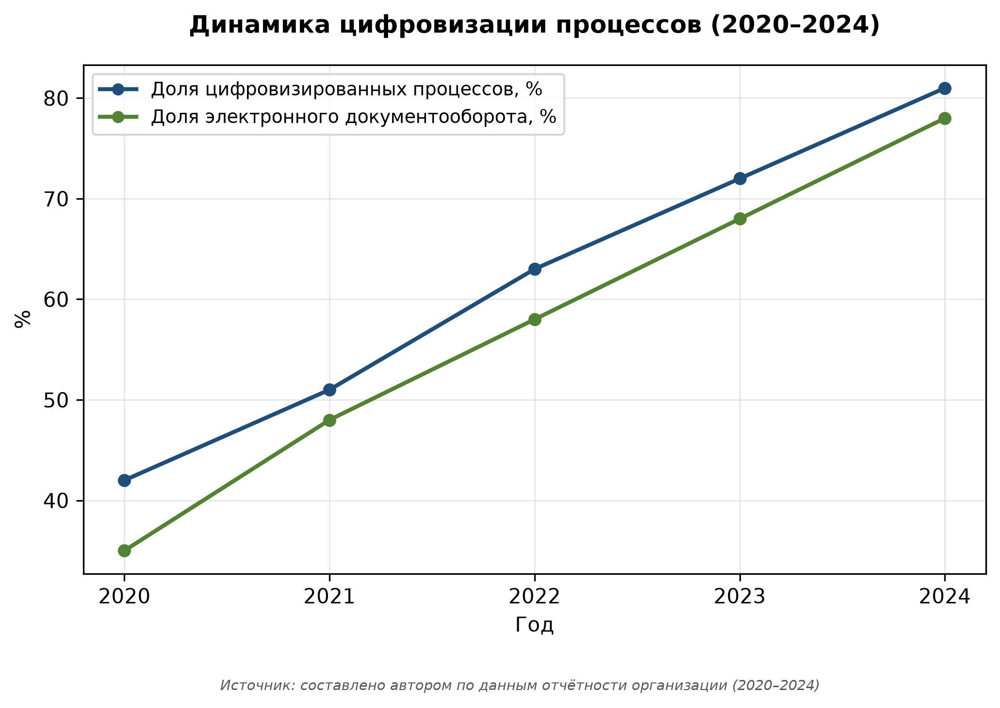
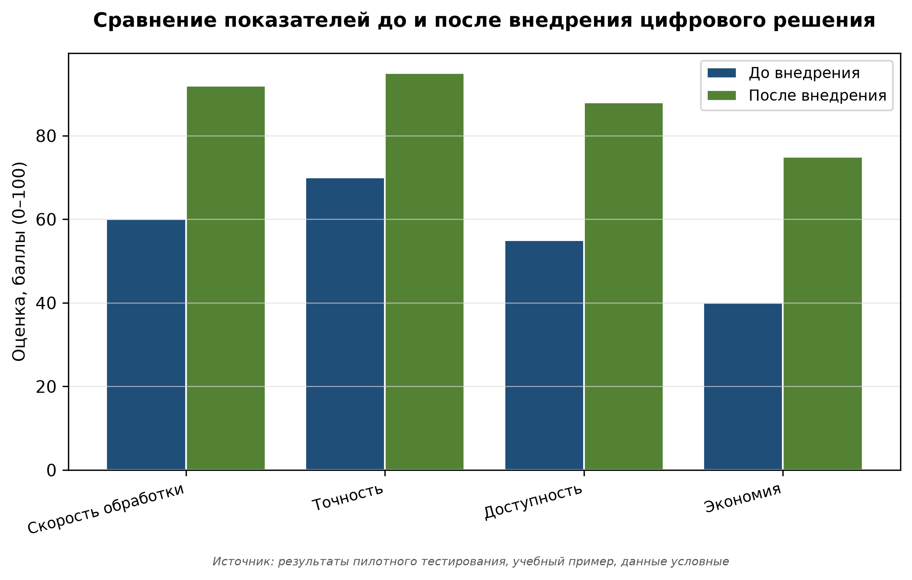
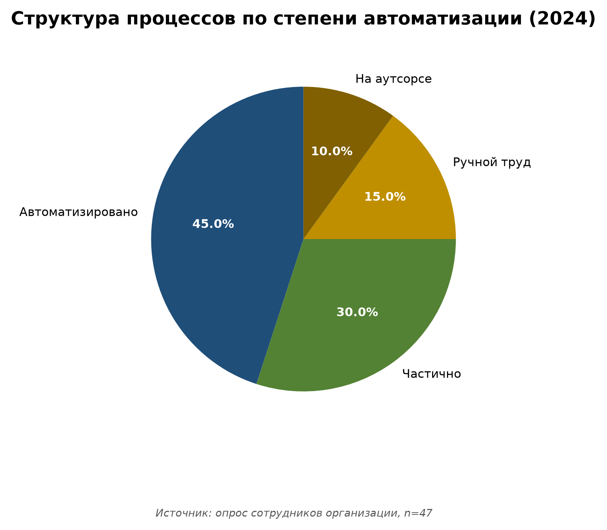
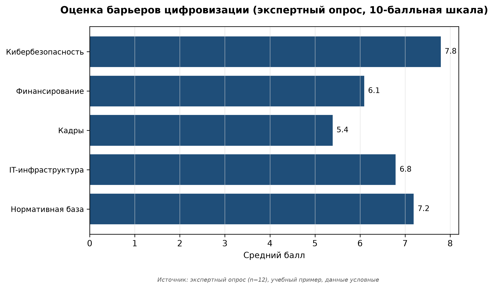
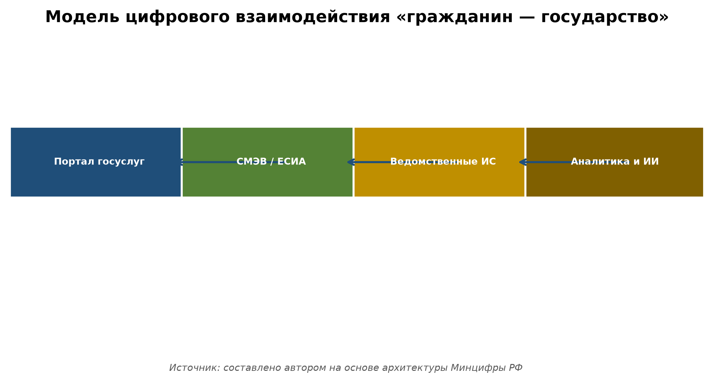
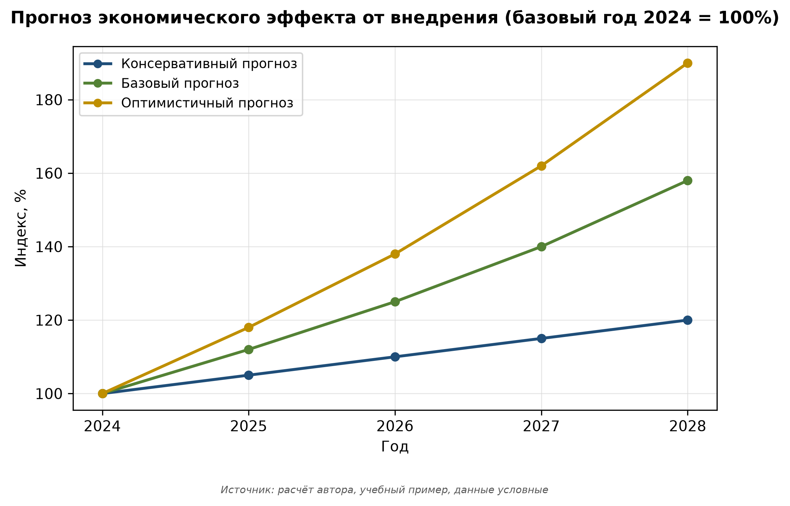
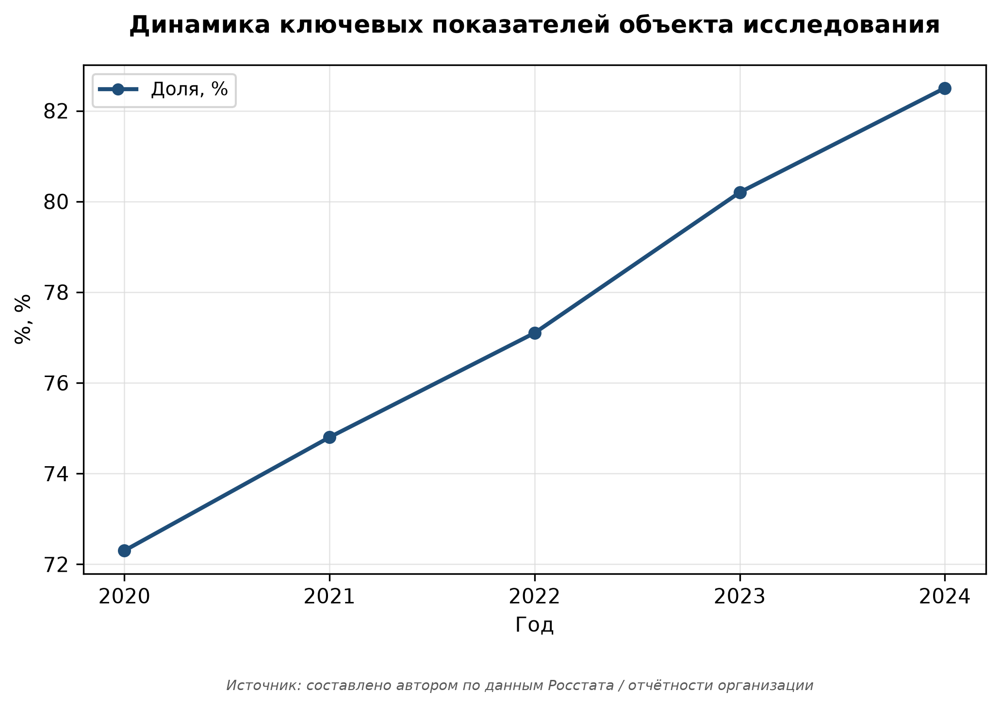

# Приложения. Иллюстрации

В данном приложении представлены все иллюстрации работы с подписями по ГОСТ.

{#fig-app-1}

Рисунок 1 — Динамика цифровизации процессов (2020–2024). Источник: см. подпись на графике.

{#fig-app-2}

Рисунок 2 — Сравнение показателей до и после внедрения цифрового решения. Источник: см. подпись на графике.

{#fig-app-3}

Рисунок 3 — Структура процессов по степени автоматизации (2024). Источник: см. подпись на графике.

{#fig-app-4}

Рисунок 4 — Оценка барьеров цифровизации (экспертный опрос, 10-балльная шкала). Источник: см. подпись на графике.

{#fig-app-5}

Рисунок 5 — Модель цифрового взаимодействия «гражданин — государство». Источник: см. подпись на графике.

{#fig-app-6}

Рисунок 6 — Прогноз экономического эффекта от внедрения (базовый год 2024 = 100%). Источник: см. подпись на графике.

{#fig-app-7}

Рисунок 7 — Динамика ключевых показателей объекта исследования. Источник: см. подпись на графике.
