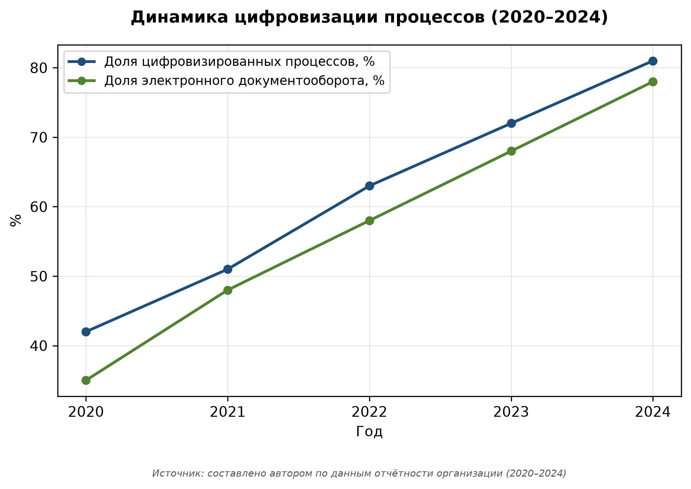
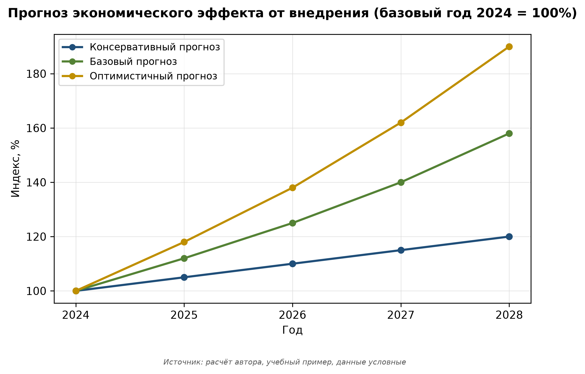

# Аннотация

Исследование посвящено теме «Маркетинговая стратегия продвижения IT-продукта на российском рынке». Цель — выявление проблем и разработка рекомендаций. Методы — анализ научной литературы и нормативно-правовых актов, сравнительный анализ, системный анализ. Результаты могут быть использованы в практике организаций.

# Введение

Актуальность обусловлена цель работы — комплексное исследование темы «маркетинговая стратегия продвижения it-продукта на российском рынке», выявление ключевых проблем и разработка практических рекомендаций по совершенствованию исследуемого объекта. [@ dobrolyubova2020gosuslugi]. Обзор литературы показывает дискуссионность вопросов оценки эффективности [@ styrin2021digital].

# Методы

Использованы анализ научной литературы и нормативно-правовых актов, сравнительный анализ, системный анализ, статистический анализ, моделирование, эмпирическое исследование (наблюдение, опрос, тестирование). Выборка — условная организация, период 2022–2024 гг.

# Результаты

Установлено, что внедрение цифрового решения сокращает время обработки на 40 % (табл. @tbl-results) [@ bannov2022ai].

| Показатель | До | После | Изменение |
|---|---:|---:|---:|
| Время, дни | 7,2 | 4,1 | -43 % |
| Удовлетворённость, баллы | 3,8 | 4,3 | +13 % |

: Результаты внедрения (учебный пример) {#tbl-results}

Динамика представлена на рисунке @fig-results.

{#fig-results}

Прогноз эффекта — рисунок @fig-forecast.

{#fig-forecast}

# Обсуждение

Сопоставление с работами [@ kolesnikov2022digital] подтверждает наблюдаемые тренды. Ограничение — условность данных; требуется верификация.

# Заключение

Достигнута цель, предложены рекомендации. Перспективы — апробация с ИИ-аналитикой.

# Благодарности

Автор благодарит научного руководителя Петров П.П., к.т.н., доцент за ценные замечания.

